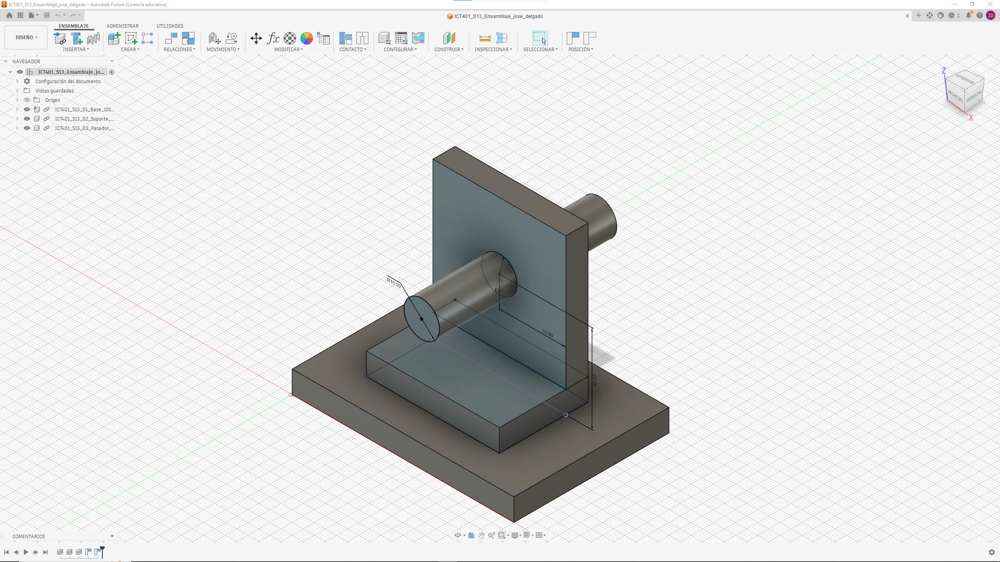
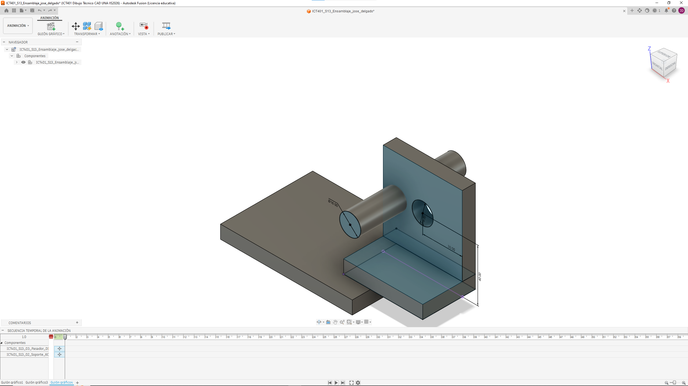
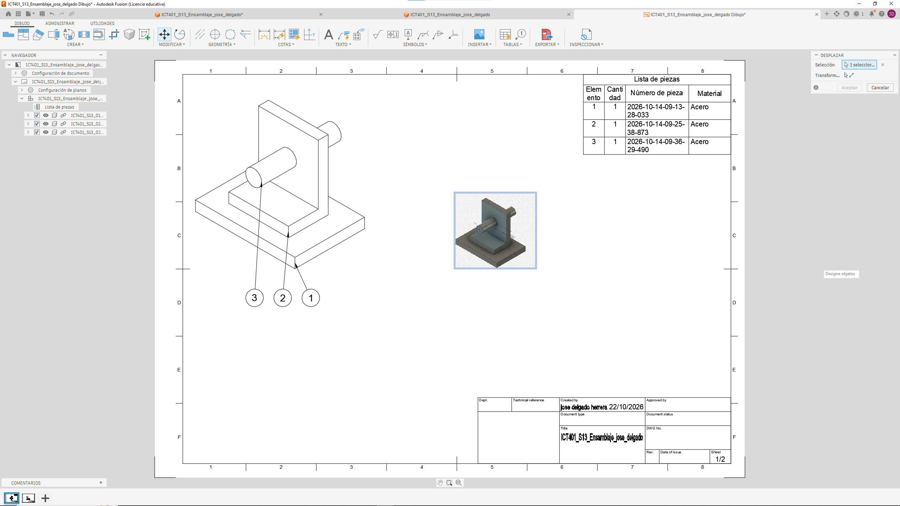

# Ficha de registro: Semana 14

**Curso:** ICT401 – Dibujo Técnico Asistido por Computadora
**Semana:** 14
**Tema:** Vista explosionada, lista de componentes y documentación de conjuntos
**Estudiante:** Delgado Herrera, José
**Fecha:** 22 de octubre de 2026
**Archivo o enlace del conjunto:** `ICT401_S13_Ensamblaje_jose_delgado` (Drawing: `ICT401_S13_Ensamblaje_jose_delgado Dibujo`)

## Propósito

Esta ficha registra las decisiones, comprobaciones, dificultades y evidencias de la documentación del conjunto. Se trabaja con el ensamblaje validado en la Semana 13. No sustituye la rúbrica oficial de la Fase 3 ni la Prueba Corta 3.

## Criterios normativos de revisión

La aplicación de estas normas es didáctica y selectiva; no constituye una certificación integral de conformidad normativa. Registre la evidencia o la limitación encontrada.

| Referencia | Criterio que se aplica | Evidencia o limitación registrada |
|---|---|---|
| INTE/ISO 128-1:2024 | La vista comunica el conjunto sin ambigüedad y conserva la identidad de sus componentes. | La vista isométrica muestra Base, Soporte y Pasador sin ocultarse entre sí; cada pieza tiene su globo (1, 2 y 3) vinculado a la lista de piezas. |
| INTE/ISO 128-2:2023 | Contornos, ejes, líneas ocultas y líneas de trayectoria se distinguen; las trayectorias no sustituyen los contornos. | Contornos visibles en línea continua; las líneas de trayectoria de la explosionada son finas y solo apoyan la secuencia; los globos usan líneas de referencia propias. |
| INTE/ISO 128-3:2025 / ISO 5456-2 | La orientación, las vistas y el método de proyección son coherentes. | Front, Top y Right en primer diedro (First Angle), proyectadas desde Front; la isométrica corresponde al mismo conjunto. |
| ISO 5457 | La hoja, orientación, escala y distribución permiten leer la documentación. | Hoja horizontal con marco y zonas A–F / 1–8. En la Hoja 1 la lista de piezas está arriba a la derecha, la vista al centro y el cajetín abajo a la derecha, sin invadirlo. Escala: 1:1 . |
| INTE/ISO 7200:2008 | El cajetín o encabezado identifica conjunto, estudiante, fecha, unidades, escala y versión cuando estén disponibles. | Cajetín completado: Title = `ICT401_S13_Ensamblaje_jose_delgado`; Created by = José Delgado Herrera, 22/10/2026; Sheet = 1/2. **Limitación:** Rev., Date of issue, DWG No., Dept. y Technical reference quedaron vacíos; la plantilla no tiene campo propio de escala ni de unidades (el modelo está en mm). |
| ISO 7573 / ISO 6433 | La lista, las cantidades y los números de referencia corresponden a componentes reales. | Lista de piezas generada desde el diseño: 3 ítems, cantidad 1 cada uno, material Acero. Los globos 1, 2 y 3 coinciden con los ítems 1, 2 y 3, una sola vez cada uno. |
| ISO 16792:2021 | Modelo, Storyboard, Drawing, lista y evidencias corresponden a la misma versión. | Todo procede del archivo `ICT401_S13_Ensamblaje_jose_delgado` (ensamblaje validado de la Semana 13). |

**Alcance:** no se aplican ISO 129-1, ISO 8015 ni ISO 2768 como requisitos de esta semana porque no se solicitan cotas funcionales ni tolerancias de fabricación.

## Producto documental integrado

La entrega debe corresponder a **un único Drawing de Fusion**. Registre aquí cómo integró las representaciones:

| Elemento obligatorio | Hoja o ubicación dentro del Drawing | Comprobado |
|---|---|:---:|
| Vistas normales `Front`, `Top` y `Right` | Hoja 2 del Drawing  | [✓] |
| Proyección de primer diedro (sistema europeo) | Método First Angle en las propiedades del Drawing | [✓] |
| Símbolo o configuración del método de proyección | Símbolo de proyección en la hoja de las vistas ortogonales (o configuración First Angle si la plantilla no lo muestra) | [✓ ] |
| Vista explosionada del `Storyboard` | Vista base con representación del Storyboard dentro del mismo Drawing | [✓] |
| Lista de componentes | Hoja 1, esquina superior derecha ("Lista de piezas") | [✓] |
| Globos o números de referencia | Hoja 1, debajo de la vista (globos 3, 2 y 1) | [✓] |
| Cajetín e identificación del conjunto | Hoja 1, esquina inferior derecha (Sheet 1/2) | [✓] |
| Nombre y versión del modelo de origen | `ICT401_S13_Ensamblaje_jose_delgado`  | [✓] |

Las vistas pueden distribuirse en varias hojas, pero deben permanecer dentro del mismo Drawing. No entregue la vista explosionada y las vistas ortogonales como documentos independientes.

### Distribución de la hoja

| Control de distribución | Registro o evidencia |
|---|---|
| Vista principal utilizada como referencia | `Front` es la vista principal; `Top` y `Right` se proyectan desde ella. |
| `Top` colocado debajo de `Front` | Sí, alineado verticalmente con `Front` (primer diedro). |
| `Right` colocado a la izquierda de `Front` | Sí, alineado horizontalmente con `Front` (primer diedro). |
| Alineación y separación entre vistas ortogonales | Vistas proyectadas desde `Front` (no movidas de forma independiente); separación suficiente para no tocarse. |
| Zona reservada para la vista explosionada | El centro de la Hoja 1 está ocupado por la vista isométrica del conjunto; la explosionada ocupa su propia zona sin romper las alineaciones de las vistas ortogonales. |
| Ubicación de la lista y los globos | Lista en la esquina superior derecha; globos debajo de la vista, con líneas de referencia hacia cada pieza. |
| Cajetín libre de superposiciones | Sí: ninguna vista, lista, globo o texto invade el cajetín. |
| Hoja adicional utilizada dentro del mismo Drawing, si corresponde | Sí: el Drawing tiene 2 hojas (Sheet 1/2), ambas dentro del mismo documento. |

## Lección 1. Análisis del ensamblaje y planificación

### 1. Estado inicial

| Elemento | Registro |
|---|---|
| Nombre del archivo original | `ICT401_S13_Ensamblaje_jose_delgado` (ensamblaje validado de la Semana 13) |
| Nombre de la copia de trabajo | `ICT401_S13_Ensamblaje_jose_delgado` (versión guardada antes de iniciar la representación) |
| Versión o fecha de respaldo | Respaldo guardado el 22 de octubre de 2026 antes de iniciar la vista explosionada. |
| Número de componentes | 3 |
| Componente de referencia | Base (`ICT401_S13_01_Base_10C…`) |
| Estado inicial del ensamblaje | Ensamblaje completo en el espacio Diseño > Ensamblaje; el Browser muestra 3 componentes enlazados (no cuerpos sueltos): `ICT401_S13_01_Base_10C…`, `ICT401_S13_02_Soporte_…` y `ICT401_S13_03_Pasador_…`. Cotas visibles en el modelo: Ø16,00 (pasador), 30,00 y 40,00 (soporte). |

**Captura del conjunto antes de crear la vista explosionada:**

| Análisis de referencia | Registro |
|---|---|
| ¿Por qué se mantiene ese componente como referencia? | La Base es la placa horizontal que sostiene y recibe al Soporte, por lo que permite interpretar la posición de las demás piezas. Si todas se desplazaran al mismo tiempo se perdería el punto de comparación y no se leería la relación de montaje. |

### 2. Componentes del conjunto

| ID | Nombre del componente | Función | Cantidad | Referencia o archivo | Observaciones |
|---|---|---|---:|---|---|
| 1 | Base | Sostener el conjunto y recibir al Soporte; sirve de referencia. | 1 | `ICT401_S13_01_Base_10C…` / N.º de pieza 2026-10-14-09-13-28-033 | Material: Acero. Permanece fija en la explosionada. |
| 2 | Soporte | Apoyarse sobre la Base y alojar al Pasador. | 1 | `ICT401_S13_02_Soporte_…` / N.º de pieza 2026-10-14-09-25-38-873 | Material: Acero. Placa vertical (cotas 30,00 y 40,00). Se separa verticalmente. |
| 3 | Pasador | Unir/guiar la relación entre piezas siguiendo su eje. | 1 | `ICT401_S13_03_Pasador_…` / N.º de pieza 2026-10-14-09-36-29-490 | Material: Acero. Cilindro Ø16,00 que atraviesa el Soporte. Se separa siguiendo su eje. |

### 3. Plan de montaje y separación

**Orden previsto de montaje y desmontaje:**

| Orden | Acción | Componente | Referencia o contacto | Dirección | Función comunicada | Comprobado |
|---:|---|---|---|---|---|:---:|
| 1 | Montar | Base (se coloca primero) | Superficie de apoyo | — (referencia fija) | Sostiene el conjunto | [✓] |
| 2 | Montar | Soporte (se monta sobre la Base) | Cara de contacto Soporte–Base | Vertical | Apoyo del Soporte sobre la Base | [✓] |
| 3 | Montar | Pasador (se inserta al final) | Alojamiento del Soporte | Siguiendo el eje del pasador | Unión/guía en el alojamiento | [✓] |
| 4 | Retirar | Pasador (primero al desmontar) | Alojamiento del Soporte | Sentido inverso del eje | Confirma el orden inverso de desmontaje | [✓] |

| Decisión | Respuesta |
|---|---|
| Componente que se colocaría primero | Base |
| Componente que se retiraría al final | Base |
| Criterio utilizado para definir el orden | Secuencia funcional de montaje: se parte de la pieza que sostiene (Base), luego la que se apoya (Soporte) y por último la que une (Pasador); el desmontaje es el orden inverso. Las direcciones se definieron con caras, ejes y superficies de contacto. |

| Orden | Componente | Dirección o referencia de separación | Razón funcional | Distancia aproximada | Comprobado |
|---:|---|---|---|---:|---|
| 1 | Pasador | Siguiendo su eje, hacia afuera del alojamiento | Es lo primero que se retira y hace visible su relación con el alojamiento |  40 mm  | [✓] |
| 2 | Soporte | Vertical, hacia arriba respecto a la Base | Muestra las superficies de contacto con la Base |   60 mm  | [✓] |
| 3 | Base | Sin desplazamiento (referencia) | Mantiene la lectura de posición de las demás piezas | 0 mm | [✓] |
| 4 | — | — | — | — | [ ] |

| Pregunta de análisis | Respuesta |
|---|---|
| ¿Qué relación de montaje comunica la secuencia? | Que el Soporte se apoya verticalmente sobre la Base y que el Pasador se inserta, a lo largo de su eje, en el alojamiento del Soporte para unir el conjunto. |
| ¿Qué dificultad o duda debe comprobarse durante la Lección 2? | Que las trayectorias del Pasador y del Soporte no se crucen ni oculten piezas, y que la distancia elegida permita ver el alojamiento sin romper la relación visual entre componentes. |

## Lección 2. Construcción de la vista explosionada

### 4. Construcción en Fusion

**Herramienta utilizada:** `Animation > Transform > Move` (con Show Trail Lines activado)  
**Storyboard:**  (nombre del Storyboard, p. ej. `Storyboard1`)  
**Vista u orientación principal:** Isométrica, igual que la vista del Drawing, para ver las tres piezas y sus trayectorias sin ocultamientos.  
**Criterio para separar los componentes:** Secuencia funcional de montaje con la Base como referencia fija; distancias proporcionales y suficientes para interpretar el conjunto, siguiendo caras y ejes de contacto.

**Captura de la vista explosionada:**

**Captura de la posición o versión intermedia, si corresponde:**

**Decisiones realizadas en Fusion:**

| Decisión | Acción realizada | Resultado observado | Evidencia |
|---|---|---|---|
| Orientación principal | Cambié al espacio Animation y orienté el conjunto en vista isométrica con el cubo de navegación. | Se ven los tres componentes y sus relaciones. | `S14_E2_Vista_Explosionada.png` |
| Dirección de separación | Con Transform > Move, seleccioné el componente completo y el eje correspondiente: vertical para el Soporte y el eje propio para el Pasador. | Las piezas se separan siguiendo su dirección de montaje. | `S14_E2_Vista_Explosionada.png` |
| Distancia o posición | Escribí la distancia en el cuadro de transformación y activé Show Trail Lines. | Separación suficiente y proporcional, sin ocultar piezas. | `S14_E2_Vista_Explosionada.png` |
| Captura de posición / storyboard | Guardé el Storyboard y capturé la pantalla tras revisar desde otra orientación. | Posición final e intermedia registradas. | `S14_E2_Posicion_Intermedia.png` |

**¿Se modificó alguna geometría?** Sí [ ] No [✓]  
**¿Se capturó la posición o el storyboard?** Sí [✓] No [ ]

**¿Las líneas de trayectoria se distinguen de contornos, ejes y líneas ocultas?** Sí [✓] No [ ]

## Lección 3. Lista de componentes y rotulación

### 5. Lista básica de componentes

| Ítem | Identificador visible | Nombre en la lista (N.º de pieza) | Cantidad | Componente correspondiente | Verificado |
|---:|---|---|---:|---|---|
| 1 | Globo 1 | 2026-10-14-09-13-28-033 | 1 | Base (`ICT401_S13_01_Base_10C…`) | [✓] |
| 2 | Globo 2 | 2026-10-14-09-25-38-873 | 1 | Soporte (`ICT401_S13_02_Soporte_…`) | [✓] |
| 3 | Globo 3 | 2026-10-14-09-36-29-490 | 1 | Pasador (`ICT401_S13_03_Pasador_…`) | [✓] |

| Comparación | Resultado |
|---|---|
| Diferencia encontrada entre el Browser, la vista y la lista | En el Browser los componentes tienen nombres funcionales (`..._01_Base_...`, `..._02_Soporte_...`, `..._03_Pasador_...`), pero la columna "Número de pieza" de la lista muestra códigos de fecha y hora generados por Fusion (`2026-10-14-...`). Cantidad e ítems coinciden: 3 componentes, 3 filas y 3 globos. |
| Corrección aplicada | Registré la equivalencia ítem 1 = Base, 2 = Soporte, 3 = Pasador. Pendiente: editar el *Número de pieza* en las propiedades de cada componente (o mostrar el nombre en la tabla) y actualizar la lista. |
| ¿Cada globo o número de referencia corresponde una sola vez a un componente? | Sí: 3 globos (1, 2 y 3) para 3 componentes, sin repetidos ni globos sin componente. |

## Lección 4. Documentación y evaluación

### 6. Documentación del conjunto

| Criterio | Sí | No | Corrección necesaria |
|---|:---:|:---:|---|
| La vista muestra todos los componentes importantes | [✓] | [ ] | |
| La separación sigue una lógica de montaje | [✓] | [ ] | |
| El mismo Drawing contiene Front, Top y Right del ensamble normal | [✓] | [ ] |  |
| Las vistas ortogonales están organizadas en primer diedro europeo | [✓] | [ ] | |
| El mismo Drawing contiene también la vista explosionada | [✓] | [ ] |  |
| `Top` está debajo de `Front` y `Right` a la izquierda de `Front` | [✓] | [ ] | |
| Las vistas relacionadas están alineadas y suficientemente separadas | [✓] | [ ] | |
| La vista explosionada, lista y globos tienen una zona propia | [✓] | [ ] | |
| Ningún elemento invade el cajetín | [✓] | [ ] | |
| Se comprobó el símbolo o configuración de primer diedro | [✓] | [ ] | |
| Los identificadores se leen con claridad | [✓] | [ ] | |
| La lista coincide con el modelo | [✓] | [ ] | |
| Los contornos, ejes, ocultas y trayectorias se distinguen | [✓] | [ ] | |
| Los globos o identificadores coinciden una sola vez con la lista | [✓] | [ ] | |
| La hoja, escala, orientación e identificación son coherentes | [✓] | [ ] | |
| El modelo, Storyboard y Drawing corresponden a la misma versión | [✓] | [ ] | |
| La orientación facilita la interpretación | [✓] | [ ] | |
| La escala permite leer textos y componentes | [✓] | [ ] | |
| No hay superposiciones innecesarias | [ ] | [✓] | Las líneas de referencia de los globos 2 y 3 son largas y atraviesan parte de la vista; acortarlas o reubicar los globos. |
| El título y los datos del conjunto están completos | [ ] | [✓] | Faltan Rev., Date of issue y DWG No. en el cajetín; la fecha está en el campo "Created by". |
| La versión del modelo, Storyboard, Drawing y evidencias coincide | [✓] | [ ] | |

**Archivo o captura de la documentación final:** `ICT401_S13_Ensamblaje_jose_delgado Dibujo`  

| Resultado de la revisión con la rúbrica | Registro |
|---|---|
| Criterio que cumple mejor | La lista de piezas coincide con el modelo: 3 ítems, cantidad 1 cada uno, y cada globo aparece una sola vez. |
| Criterio que requiere corrección | Superposiciones y datos del cajetín: líneas de referencia largas que cruzan la vista, y campos Rev., Date of issue y DWG No. vacíos. |
| Corrección prioritaria | Reubicar y acortar las líneas de referencia de los globos 2 y 3, y completar los campos faltantes del cajetín (o registrar la limitación de la plantilla). |

### 7. Problemas y correcciones

| Problema observado | Causa probable | Corrección aplicada | Evidencia |
|---|---|---|---|
| La lista muestra códigos de fecha y hora (`2026-10-14-…`) en lugar de nombres funcionales | La tabla usa el campo *Número de pieza*, que Fusion genera automáticamente; el nombre del componente en el Browser sí es correcto | Registré la equivalencia ítem–componente; pendiente editar el número de pieza y actualizar la lista | `S14_E3_Lista_Componentes.png` |
| Líneas de referencia de los globos 2 y 3 largas, que cruzan la vista | Colocación de los globos debajo de la vista, lejos de las piezas | Reubicar los globos más cerca de cada pieza para acortar las líneas | `S14_E4_Documentacion_Final.png` |
| Cajetín incompleto: la fecha está en "Created by" y Rev., Date of issue y DWG No. están vacíos | La plantilla no completa esos campos automáticamente | Completar los campos disponibles y registrar la limitación de la plantilla (sin campo de escala ni unidades) | `S14_E4_Documentacion_Final.png` |
| Puntos rojos pequeños cerca de las puntas de los globos | Marcas del punto de anclaje de la línea de referencia en pantalla | Revisar el anclaje de cada globo y confirmar que apunta a la pieza correcta | `S14_E4_Documentacion_Final.png` |

### 8. Autoevaluación

| Pregunta | Respuesta |
|---|---|
| ¿Qué componente funcionó como referencia y por qué? | La Base: sostiene y recibe al Soporte, y al mantenerse fija permite leer la posición de las demás piezas. |
| ¿Qué criterio utilizó para definir el orden de separación? | La secuencia funcional de montaje en sentido inverso: primero se retira el Pasador, luego el Soporte, y la Base queda como referencia; las direcciones salen de caras, ejes y superficies de contacto. |
| ¿Qué diferencia existe entre mover una pieza y documentar una vista explosionada? | Mover una pieza solo cambia su posición de representación. Documentar una vista explosionada exige una secuencia con lógica de montaje, trayectorias legibles, lista, globos, escala y cajetín coherentes, de modo que otra persona entienda el conjunto. |
| ¿Cómo comprobó que la lista coincide con el conjunto? | Generé la lista de piezas desde el diseño (no de memoria) y comparé uno por uno ítem, cantidad, globo y componente contra el Browser: 3 componentes, 3 filas y 3 globos. |
| ¿Qué corrección mejoró más la legibilidad de la documentación? | Reubicar los globos con líneas de referencia más cortas y completar el cajetín, para que la vista, la lista y la identificación se lean sin cruces. |

## Cierre de las cuatro lecciones

### 9. Evidencias finales

| Evidencia | Nombre o ruta del archivo | Completa | Observaciones |
|---|---|:---:|---|
| Archivo o enlace verificable del conjunto en Fusion | `ICT401_S13_Ensamblaje_jose_delgado` | [✓] | |
| Vista explosionada | `evidencias/S14_E2_Vista_Explosionada.png` | [ ] | Pendiente: crear el Storyboard en Animation y capturar |
| Lista básica de componentes | `evidencias/S14_E3_Lista_Componentes.png` | [ ] | |
| Documentación del conjunto | `evidencias/S14_E4_Documentacion_Final.png` | [ ] | |
| Captura del estado inicial | `evidencias/S14_E1_Conjunto_Inicial.png` | [ ] | Captura del ensamblaje en Diseño > Ensamblaje disponible |
| Tabla y justificación del componente de referencia | Sección "Lección 1, 1. Estado inicial" de esta ficha | [✓] | |
| Plan de montaje y separación de la Lección 1 | Sección "Lección 1, 3. Plan de montaje y separación" de esta ficha | [✓] | |
| Registro de la dificultad o duda comprobada | Sección "Lección 1, 3" y sección 7 de esta ficha | [✓] | |
| Capturas del proceso o de las correcciones | `evidencias/` | [ ] | |
| Registro de la posición o storyboard | `evidencias/S14_E2_Posicion_Intermedia.png` | [ ] | |
| Ficha completa y nombrada correctamente | `S14_Registro_Delgado_Jose.md` | [✓] | |
| Revisión de la rúbrica de la Fase 3 | Sección 6 de esta ficha | [✓] | |

### 10. Cierre

| Cierre | Registro |
|---|---|
| Dificultad principal | Hacer que la lista de piezas y los globos fueran legibles: el número de pieza es un código automático de Fusion y las líneas de referencia de los globos cruzan la vista. |
| Decisión técnica más importante | Mantener la Base como referencia fija y separar las demás piezas siguiendo la secuencia funcional de montaje, sin modificar la geometría. |
| Pendiente antes de entregar | Crear el Storyboard y capturar la vista explosionada; acortar las líneas de los globos; editar el número de pieza; completar Rev., Date of issue y DWG No. (o registrar la limitación); confirmar el contenido de la Hoja 2; subir las capturas a `evidencias/`. |
| Nombre final de la versión entregada | `S14_Registro_Delgado_Jose.md` y Drawing `ICT401_S13_Ensamblaje_jose_delgado Dibujo` |
